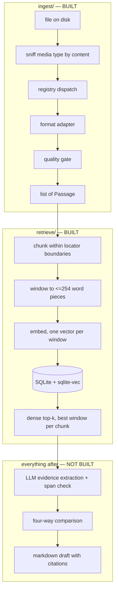
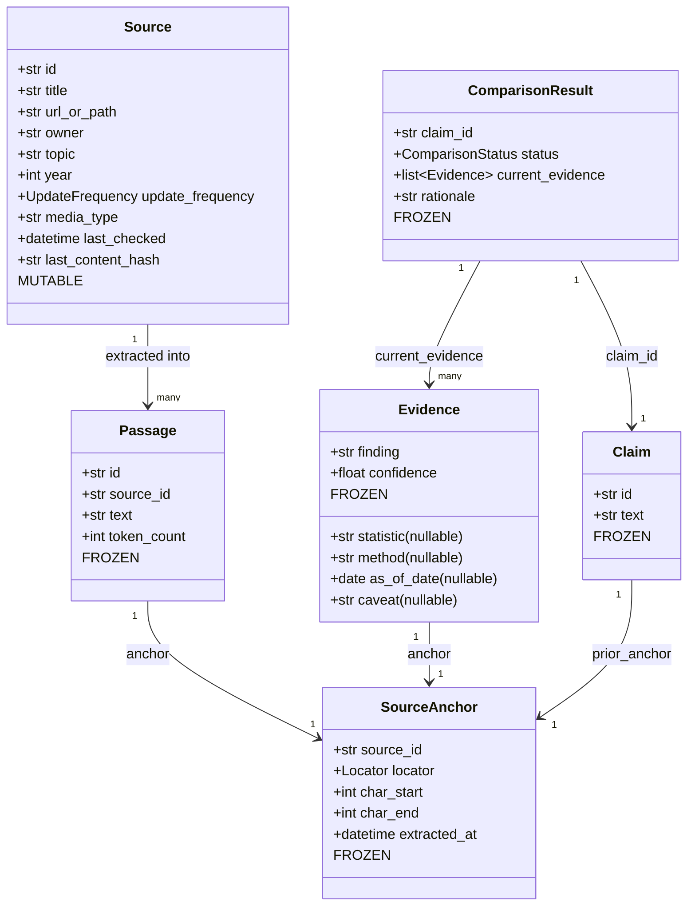
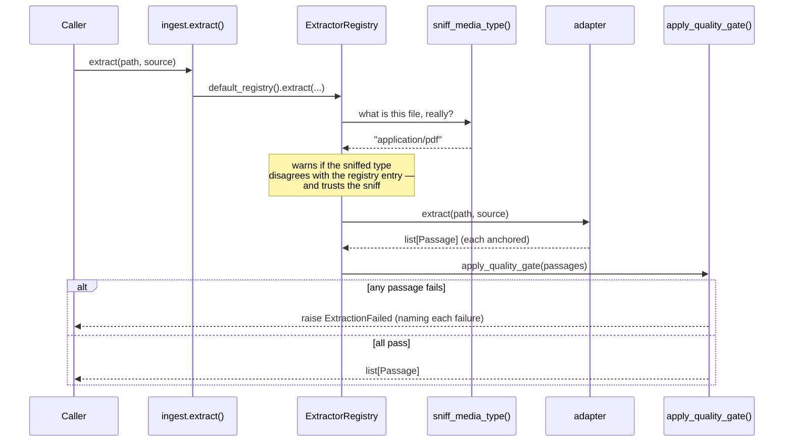
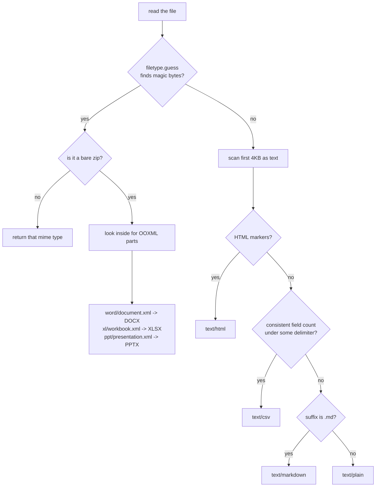
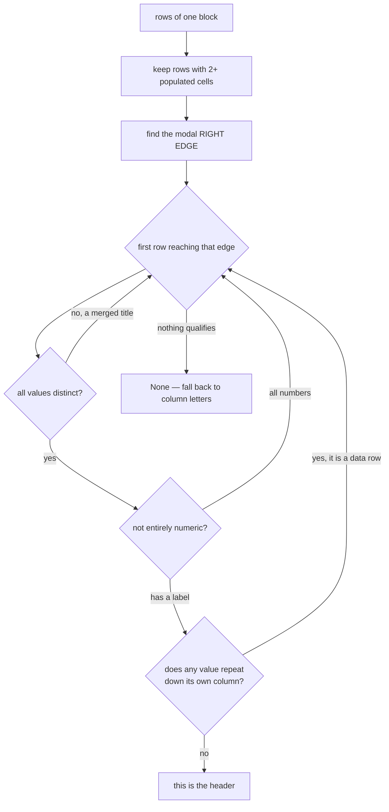
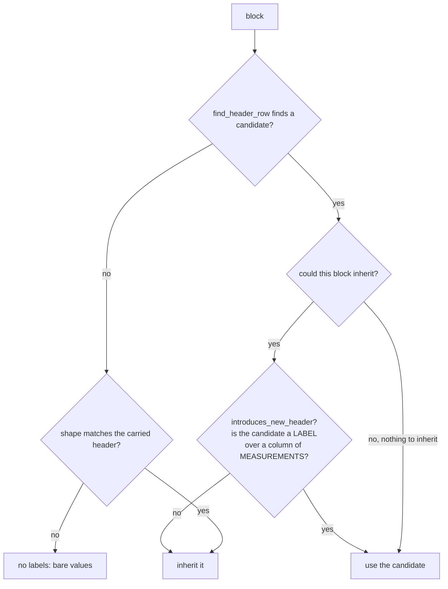

# ASIL Annual Research Update Agent — Project Overview

*A standalone walkthrough of what this project is, what has been built, and how
the code fits together. Written 2026-08-30 against commit `2fb3f75`; rewritten
2026-09-08 against commit `bf8cc13`, when steps 1 and 2 were both complete.*

This document is for reading, not for the build. `BUILD_SPEC.md` is the
contract, `DESIGN.md` is the rulebook and decisions log, `BACKEND_PLAN.md`
is the build order. Nothing here overrides any of them — it explains them, and
explains the code that has been written against them so far.

---

## 1. What the system is

A **retrieval-first research update agent** for A Start in Life (ASIL), a
nonprofit that publishes an annual research report on youth skills, employment
and education outcomes.

Each year, somebody at ASIL has to go back through a list of approved sources —
government workbooks, sector skills reports, research PDFs, publisher web pages
— work out what changed since last year, and rewrite the report's findings
accordingly. That job is slow, and it is the kind of slow work where a mistake
is invisible: a statistic that quietly went stale reads exactly like one that
was checked.

The system automates the *checking*, not the *publishing*. Given last year's
report broken into claims, and this year's approved sources, it produces a
**draft** in which:

- every material sentence carries an inline citation that points at a specific
  page, paragraph or cell range in a specific approved document;
- every prior-year claim is classified as `unchanged`, `updated`, `new` or
  `cannot-verify`, each with a written rationale;
- anything the sources do not support is flagged as unverifiable rather than
  filled in with plausible text.

A human reviewer then approves, edits or rejects each claim. The system never
publishes.

### The one-sentence version

> It re-reads approved sources, tells you what changed, and shows you exactly
> where it read it — and when it does not know, it says so.

---

## 2. Where the project stands today

Five commits in. Roughly **5,200 lines of source, 3,900 lines of tests, 208
tests passing** in about four seconds.

```
Step 0  Skeleton and data model .................... DONE
Step 1  Ingestion adapter layer .................... DONE (PPTX outstanding)
Step 2  Chunking and retrieval ..................... DONE (dense only; BM25 next)
Step 3  Evidence extraction ........................ not started
Step 4  Change detection and comparison ............ not started
Step 5  Draft generation ........................... not started
Step 6  Evaluation harness ......................... not started
Step 7  Review UI (Streamlit) ...................... not started
```

The approved-source registry came with step 2 rather than step 1. It belongs to
`BUILD_SPEC.md`'s phase 1 and had been deferred; building retrieval on top of
fabricated `Source` objects would have meant rewiring it later, and design rule
3 would have stayed a convention for another whole stage.

| Package | State | Lines |
|---|---|---|
| `models.py` | complete | 322 |
| `ingest/` | complete bar PPTX | 2,035 |
| `retrieve/` | chunk, embed, store, dense search | 1,643 |
| `registry/` | complete | 433 |
| `cli.py` | `ingest` and `search` | 239 |
| `serde.py` | locator round trips | 170 |
| `certs.py` | OS trust store | 115 |
| `provenance.py` | complete | 82 |
| `citations.py` | locator rendering | 68 |
| `eval/` | stub with brief | 23 |
| `compare/` | stub with brief | 21 |
| `draft/` | stub with brief | 17 |
| `extract/` | stub with brief | 15 |

The four remaining stubs are **documented briefs** — a module docstring stating
what that stage must do and which spec section governs it, and an empty
`__all__`. That is deliberate: the docstring is the brief for whoever
fills it in.

### What actually runs today

```sh
uv run updater ingest                    # registry -> index
uv run updater search "<query>"          # retrieve, with anchors
uv run python scripts/dump_passages.py data/sources --chunk
uv run python scripts/dump_passages.py data/sources --worst 10
```

`updater ingest` reads `registry.yaml`, refuses anything not in it, and takes
each approved document through extraction, chunking, embedding and storage.
On ASIL's real material that is **740 chunks and 742 vectors over seven
documents in about 30 seconds**, all of it anchored: 316 block locators (DOCX
paragraphs) and 424 cell locators (table rows).

The eighth registered document is `ASIL_Enterprise_Skills_Briefing_2026.pptx`.
There is no PPTX adapter, so ingest reports `UnsupportedMediaType` against it and
exits non-zero. **It is listed in the registry anyway, on purpose**: a source
that is silently absent and a source that cannot be read are different facts,
and only one of them is visible.

---

## 3. The five rules, and where they live in the code

These are from `BUILD_SPEC.md` section 1. They are not preferences to be
balanced against convenience — each one, broken, destroys the reason the project
exists. The interesting thing about the codebase so far is how much of it is
structured so that following the rules is the *path of least resistance*.

### Rule 1 — Provenance is never lost

Every piece of text carries a `SourceAnchor` from extraction to draft. There is
no stage where text becomes a bare `str`.

**In the code:** `Passage` and `Evidence` cannot be constructed without an
`anchor`. All five provenance records are `frozen=True`, so an anchor cannot be
edited after the fact — an editable anchor is not provenance. And
`provenance.py` provides `require_derives_within(parent, child)`, the callable
form of "a chunk may not span two pages", written *before* the chunking stage
existed so it could not be relaxed to fit code that already violated it.
**`retrieve/chunk.py` now calls it on every chunk it emits** — the stage it was
written for, arriving a stage later and finding the invariant already there.

### Rule 2 — Abstention over confabulation

If evidence is not retrieved, emit `cannot-verify`. Never fill a gap with
plausible text.

**In the code:** every optional field on `Evidence` defaults to `None`, so
returning nothing is the *least* work an extractor can do. `ComparisonStatus`
treats `CANNOT_VERIFY` as the default outcome, not the error case. In the
tabular layer, a column with no header becomes `"Column D"` rather than a
guessed name, an empty cell contributes no text at all (there is no `Header: —`
and no `"N/A"`), and `find_header_row` returning `None` is a legitimate answer.

### Rule 3 — Approved sources only

No open web search, no model world-knowledge in the draft.

**In the code:** the `registry/` package is the boundary, and it is now a
*function* rather than a convention. `Registry.source_for_path` and
`Registry.get` refuse; refusing means there is no `Source`; and without a
`Source` nothing can be ingested, chunked, embedded or cited. `updater ingest`
on an unregistered file exits 2 before reading a byte of it.

`registry.yaml` is committed, because an approved-source list that is not in
version control cannot be audited — which is the whole point of the rule. Its
`owner`, `topic` and `year` fields were filled in from filenames and are marked
in the file as needing ASIL's review; they are the two things nobody can derive
from a document's bytes.

The one place a `Source` is still fabricated is `scripts/dump_passages.py`, a
developer inspector whose output never becomes evidence. Its justification has
changed shape rather than expired: it is no longer "there is no registry yet"
but "this exists to look at a document *before* anybody has approved it". It
fills `owner` and `topic` with `"unknown (not from the registry)"` rather than
guessing, and carries an explicit instruction not to import that function into
anything that retrieves or drafts.

### Rule 4 — Every material claim carries a citation

**In the code:** the linter is still the `draft/` package's job. Half the
machinery now exists though: `citations.py` renders a locator as the thing a
reviewer would use to find the text by hand — "p. 14",
"Salary Premiums!A13:D13", "paragraph 194" — and `updater search` prints one for
every hit, so the anchors can be checked against the documents today, before any
model is involved.

### Rule 5 — Human sign-off is mandatory

**In the code:** the review UI is step 7. Nothing in the system has a publish
path, and nothing should acquire one.

### What the rules rule out in practice

- Generating a plausible statistic when retrieval returned nothing.
- Dropping a `cannot-verify` claim to make the draft read better.
- Letting a chunk span two PDF pages, two slides or two cell ranges.
- Skipping the verbatim-span string match on extracted evidence.
- Reaching for the web to fill a registry gap.

---

## 4. Architecture at a glance

### The pipeline


Green is built. Amber is built but incomplete: retrieval is dense-only, and
BUILD_SPEC.md section 4 asks for hybrid — which on this corpus is not a
refinement but a correctness requirement, for the reason in section 11. Grey is
a documented stub.

`fetch` is grey by choice rather than oversight. It owns content hashing and
snapshots, which belong with change detection in step 4; the index today is
built from files already on disk.

### What moves between the stages

A single type does almost all the work: **`Passage`** — a span of text that
knows where it came from.



Note where the fan-out and fan-in happen. A passage becomes one or more chunks;
a chunk becomes one or more embedding windows; and then the windows collapse
back to chunks at retrieval, scored by the best one. **The chunk is the unit of
provenance throughout** — windows never get anchors of their own, because a
window is an artefact of one model's input buffer, not a place in a document.

The design property worth noticing: **adding a format touches two files.** One
adapter module in `ingest/adapters/`, one locator variant in `models.py`.
Nothing downstream changes, because everything downstream consumes `Passage`.

---

## 5. The data model (`src/updater/models.py`, 322 lines)

Defined before any pipeline code, per spec section 2. Stdlib dataclasses, not
Pydantic — it keeps the model layer dependency-free. Frozen where provenance is
involved, keyword-only everywhere.

### Record relationships



### `SourceAnchor` — the citation primitive

Everything in the project is really about this one type.

```python
@dataclass(frozen=True, slots=True, kw_only=True)
class SourceAnchor:
    source_id: str
    locator: Locator           # which unit of the document
    char_start: int            # offsets INTO THAT UNIT's text
    char_end: int
    extracted_at: datetime
```

The critical, non-obvious decision: **offsets are locator-relative, not
document-relative.** `char_start=0` means the start of *that page*, or *that
paragraph*, or *that cell range* — not the start of the file.

Two things fall out of that, and both are load-bearing later:

1. The extract stage can verify a quoted span by plain string match against
   `passage.text[anchor.char_start:anchor.char_end]`. That is the cheap
   hallucination guard the spec insists on.
2. An anchor stays valid when an unrelated part of the document shifts. Insert a
   paragraph on page 3 and the anchors on page 9 are untouched.

`__post_init__` rejects a negative start and an end that precedes the start, so
the classic transposed-arguments bug cannot survive construction. This is also
why every record is keyword-only: you cannot pass `char_start`/`char_end` the
wrong way round if you have to name them.

There is deliberately **no `quote` field on `Evidence`.** The supporting span is
derived by slicing the passage with the anchor. Storing it separately would let
the quote drift out of sync with the anchor that is supposed to justify it —
which is precisely the failure the whole project exists to prevent.

### The locator union — the format-specific half of a citation

A discriminated union. Each variant carries a literal `kind` tag so it survives a
round trip through YAML, JSON and SQLite, where `isinstance` is unavailable.

| Variant | Fields | Format | Renders as |
|---|---|---|---|
| `PageLocator` | `page` | PDF, images | `p. 14` |
| `BlockLocator` | `paragraph_index`, `style` | DOCX, MD, TXT | `para 194` |
| `CellLocator` | `sheet`, `cell_range` | XLSX, CSV, DOCX tables | `Sheet1!B4:F4` |
| `SlideLocator` | `slide`, `shape_index` | PPTX (not built) | `slide 7, shape 2` |
| `DomLocator` | `css_path`, `heading_trail` | HTML | heading trail |
| `TimeLocator` | `start_sec`, `end_sec` | A/V transcripts (not built) | `12:04–12:31` |

`DomLocator.heading_trail` is a `tuple`, not a `list`, so frozen anchors stay
hashable.

### The enums

- `MediaType` — canonical IANA types. Fields that hold media types are typed
  `str`, not `MediaType`, on purpose: sniffing is authoritative, and a sniffed
  type not on the list must still round-trip rather than raise.
- `UpdateFrequency` — annual / biennial / half-yearly / quarterly / monthly /
  irregular / unknown. `UNKNOWN` is the honest default for a publisher with no
  stated cadence. There is no "biannual": it means twice a year to some readers
  and every two years to others, and the loader refuses it.
- `ComparisonStatus` — unchanged / updated / new / cannot-verify.

### Why `Source` is the one mutable type

Every provenance record is frozen. `Source` is not, because the fetch stage
writes `last_checked` and `last_content_hash` back to the registry entry after
each run.

Note what the hash is over: **the normalised extracted text, never the raw
bytes.** A PDF re-exported with a new timestamp has different bytes and
identical content, and hashing bytes would report a change every year for
sources that never changed.

---

## 6. The ingestion layer (`src/updater/ingest/`, 2,035 lines)

This is the part that is fully built, and it is where all the interesting
engineering has happened so far.

### The shape of it

```
ingest/
  __init__.py    extract() — the public entry point, and the default registry
  sniff.py       media type by content, plus CSV delimiter detection
  base.py        the Extractor protocol, the dispatch registry, build_passage()
  quality.py     the three-check extraction quality gate
  errors.py      NeedsOCR / ExtractionFailed / UnsupportedMediaType
  tabular.py     row serialisation + header detection, shared by XLSX/CSV/DOCX
  adapters/
    pdf.py       one passage per page          -> PageLocator
    html.py      one passage per block element -> DomLocator
    docx.py      paragraphs AND tables         -> BlockLocator / CellLocator
    xlsx.py      one passage per row           -> CellLocator
    csv.py       one passage per row           -> CellLocator
```

### The call path



Two structural decisions are visible in that diagram, and both were made
deliberately:

**The registry owns sniffing and the gate, not the adapters.** An adapter's
entire job is *format to passages*. Centralising means a new adapter physically
cannot forget to run the quality gate — which is the mistake that shows up
months later as a source quietly contributing nothing.

**Dispatch is on sniffed content, never on the file extension.** ASIL staff will
upload a `.txt` that is really a PDF. There is a test for exactly that.

### `sniff.py` — what is this file, really?



The extension is consulted in **exactly one place**: the final Markdown-vs-plain
tiebreak, because those two are byte-identical formats that no amount of content
sniffing can separate — and by then every binary format has already been ruled
out on content, so the spec's rule still holds where it matters.

**CSV detection is by consistency, not by counting commas.** That is the whole
test, and it is what separates a table from prose: an English paragraph has
commas, but not the *same number* of them on every line. Counting goes through
`csv.reader` rather than `str.count`, so a quoted value containing the delimiter
does not derail it. Comma, semicolon, tab and pipe are all tested — semicolon
because that is what Excel writes under a European locale.

One subtlety with a test pinning it: the last sampled line is dropped **only**
when the read actually hit the 4KB limit, since that is the only time it can be
half a row. Dropping it unconditionally throws away one of the two lines a small
file has, and a three-line CSV then sniffs as plain text.

Known limit: prose with a rigidly repeating comma pattern — an address list —
sniffs as CSV. The failure is visible rather than silent: bare unpaired rows
rather than something that looks like a clean table.

### `base.py` — the contract

```python
class Extractor(Protocol):
    media_types: ClassVar[set[str]]
    def extract(self, path: Path, source: Source) -> list[Passage]: ...
```

The registry refuses to let two adapters claim the same media type. Two adapters
silently competing for `application/pdf` is exactly the kind of thing that
surfaces months later as an inexplicable change in citation quality.

`build_passage()` is the one place a `Passage` is minted at ingest. It sets
`char_start=0` and `char_end=len(text)` because **at ingest time the passage
*is* the unit its locator names**. The chunking stage is what will narrow those
offsets — within these boundaries, never across them.

`estimate_tokens()` is a crude 4-characters-per-token estimate, and it is
deliberately bad so nobody mistakes it for real counting. The chunking stage owns
token counting, because it is the stage with a budget to respect.

### `quality.py` — the gate

Three checks over every passage:

| Check | Threshold | Catches |
|---|---|---|
| non-empty | any non-whitespace | an adapter that produced nothing |
| alphanumeric ratio | ≥ 0.60 | OCR garbage, symbol soup |
| longest token | ≤ 50 chars | ligature/encoding failures — text that lost its spaces |

Two refinements on the spec, both earned:

**The ratio check is skipped below 30 characters.** On a short fragment the
ratio is dominated by one space or bracket: `"(p. 12)"` scores 43% and is
perfectly good text.

**URLs and email addresses are exempt from the token-length check.** This was
found on real client material: a 176-character link to an Australian Senate
committee report, in the sources line of
`ASIL_Enterprise_Skills_Report_2026.docx`, failed all 161 passages of the
document. The check exists to catch text that has *lost its spaces*; a URL is
long but structured. Rejecting a research report for citing its sources properly
is the gate working against the thing it protects.

**A failure fails the whole extraction**, and that policy is unchanged and still
right. Dropping just the bad passage is what the spec rules out: the missing text
reappears downstream as an *absence of evidence*, and the compare stage reads
absence as a real finding about the world. The error names each failing passage
so a reviewer can go and look — `"page 7 is 31% alphanumeric"` is actionable in a
way `"this document is bad"` is not.

Measured margin on real ASIL files: worst-case ratio 0.697 for DOCX and 0.722 for
XLSX, against a 0.6 floor, with medians of 0.77–0.83. Not one passage came within
0.05 of failing.

### `errors.py` — three distinguishable failures

The layer never returns an empty list to mean "something went wrong", for the
reason stated above. Instead:

| Error | Means | Who acts |
|---|---|---|
| `UnsupportedMediaType` | sniffed fine, no adapter registered | developer — build the adapter |
| `NeedsOCR` | PDF text layer under 100 chars/page | operator — run `ocrmypdf` first |
| `ExtractionFailed` | adapter ran, output unusable | developer — bug report, with per-passage detail |

`NeedsOCR` matters more than it looks. A scanned page extracts to a handful of
stray ligatures rather than to *nothing*, so without the check it would pass as a
legitimately short page and quietly contribute no evidence.

---

## 7. The adapters, one by one

### PDF (`adapters/pdf.py`) — `PageLocator`

One passage per page. Blank pages produce no passage — a blank page has nothing
citable — but **page numbers are never renumbered around the gaps**, so page 9 of
the citation is page 9 of the file a reviewer opens.

Before extracting, it computes mean characters per page and raises `NeedsOCR`
below 100. OCR is deliberately not implemented; this error is the handoff point.

The page is the natural locator unit: it is what a reviewer can turn to, and it
is the boundary chunking must not cross. The adapter satisfies that *by
construction* — each page's own `extract_text()` is bound to its own page number
in a single comprehension, and there is no code path that concatenates two pages.

### HTML (`adapters/html.py`) — `DomLocator`

trafilatura strips navigation and boilerplate and returns a flat XML tree; one
passage per block element under `<main>`.

Two honest caveats are written into the module, because the field names promise
more than the format can deliver:

- **`css_path` points into trafilatura's extracted tree, not the live page.** The
  original DOM does not survive boilerplate removal, so there is nothing honest
  to put there. Treat it as a stable within-document ordinal
  (`doc > main > p:nth-of-type(2)`).
- **The heading trail is the durable half of a web citation.** It still reads
  correctly after the publisher restyles the page, which is the normal fate of a
  web source between two annual runs. Cite the trail to humans. A heading
  includes itself in its own trail, so a passage and the heading above it read
  the same way in a citation.

There is a small piece of care in `_element_text`: joining every text node with a
space puts one before the `!` in `<p>Hello <b>world</b>!</p>`, while
`"".join(itertext())` runs list items together into `"AB"`. Recursing over block
children only gets both cases right.

### DOCX (`adapters/docx.py`) — `BlockLocator` **and** `CellLocator`

Two kinds of passage, **interleaved in document order** by walking the body
element rather than reading `document.paragraphs` then `document.tables`.

Body paragraphs get a `BlockLocator`. `paragraph_index` counts *every* paragraph
including the empty ones the adapter skips, so the index addresses the real
document and a reviewer lands on the right block. Dense renumbering still
produces citations; they just point at the wrong paragraph. There is a test
pinning this.

**The bug this adapter was rewritten to fix is worth knowing about**, because it
is the archetype of what this project is defending against.
`document.paragraphs` is body-level paragraphs only — text inside a table is not
in it. Across the six real ASIL documents that is **41 tables, 990 non-empty
cells, 35,838 characters, 30% of all DOCX text** — and it is the 30% holding the
figures, because a research report keeps its numbers in tables. Nothing raised.
The documents simply yielded fewer passages, which downstream would have read as
an absence of evidence.

Table rows are anchored with `CellLocator`, not `BlockLocator`, because a table
cell is tabular data: the header-carrying serialisation (section 8) is what makes
`~55%` interpretable, and a paragraph number would throw that column meaning
away.

That decision stretched one field. `CellLocator.sheet` was "the name of a
worksheet"; it now also carries a table's identity within a document —
`Table 3 (para 194)`. The alternatives were worse: a seventh locator variant
duplicating `cell_range` for no gain, or a locator that discards the column. Both
uses answer the same question — *which grid, and where in it* — and both render
into a citation a reviewer can follow. **If a third kind of grid appears and
`sheet` starts needing to be parsed rather than read, that is the signal to split
the variant.**

The bracketed number is the index the *next* body paragraph will have, so the
table sits immediately above the paragraph named, and a table before any
paragraph is `(para 0)` rather than a special case. Row numbers are 1-based
*within the table*, so `B4` means four rows down that table — which is what a
reviewer counts.

### XLSX (`adapters/xlsx.py`) — `CellLocator`

One passage per populated row, across every sheet. Three workbook-specific
behaviours:

- **Every sheet is read, hidden ones included.** A hidden sheet is usually
  workings, but "usually" is not a basis for dropping data silently. A hidden
  sheet that contributes nothing costs a few empty rows; a hidden sheet that held
  the figures and was skipped is a missing finding.
- **Formulas are read as cached results** (`data_only=True`). `=SUM(B2:B14)` is
  not evidence about the world. A workbook saved by something other than Excel
  may have no cache, which surfaces as empty cells rather than as a wrong number.
- **Merges propagate down, never across** — see below.

### CSV (`adapters/csv.py`) — `CellLocator`

Same serialisation as XLSX, sharing `tabular.py`. The `sheet` field is the file
stem, so a citation still reads: `(sector-skills-2025!B4:F4)`.

The delimiter is taken from the sniffer rather than re-derived, so the two cannot
disagree — a file that sniffed as CSV on semicolons and was then read on commas
would produce one enormous column per row, sail through the quality gate, and be
useless to retrieve.

---

## 8. The tabular subsystem (`ingest/tabular.py`, 601 lines)

The largest and subtlest module in the project. Worth its own section, because
it is where the hardest bugs were, and none of them were the kind of bug a
cell-range assertion can see.

### The decision the layer turns on: **a passage is one row, carrying its headers**

Three options were on the table:

| Option | Verdict |
|---|---|
| one passage per **cell** | rejected — a lone `11845` anchored at `B7` is a number, not evidence; nothing can retrieve it |
| one passage per **sheet** | rejected — an anchor naming a whole sheet is unfalsifiable; a reviewer told "Sheet2" has to search it, which is the work citations exist to remove |
| one passage per **row** | chosen — a row is the record a skills workbook is made of, and `Sheet2!B4:F4` lands a reviewer on the exact cells |

Serialisation is `{sheet}. {Header}: {value}; {Header}: {value}`:

```
Apprenticeship starts by region. Region: North East; Starts 2023: 12,340; Starts 2024: 11,845
```

Three arguments for repeating the header in every row, in ascending order of how
hard they are to argue with:

1. `North East; 12340; 11845` embeds close to nothing. The numbers have no
   meaning without their columns, and a query about apprenticeship starts has no
   lexical or semantic overlap with any of it.
2. BM25 and dense retrieval both need the *column* term present, because that is
   where the subject matter lives — the body of the row is digits.
3. **Measured:** a bare `5223; 1,204; 0.34; -2.1%` scores 0.54 alphanumeric,
   under the 0.6 floor, and would fail the *whole workbook*. Paired with its
   headers the same row scores 0.69.

The cost is real and accepted: every row repeats the headers, which inflates the
index and flattens BM25's IDF for those terms within a sheet.

### What is carried, and what is not

**The sheet name is carried into each row; the title row is not.** The line
between them is whether the text is part of the *address* or part of the
*content*. `CellLocator.sheet` already names the sheet, so repeating it in the
text asserts nothing the anchor does not — and it is often the only place the
table's subject is written down. A title in `A1` is content with its own anchor.
Splicing it into a passage anchored at `B47:F47` would make the passage text stop
corresponding to the cells it cites, which is the first step of exactly the rot
rule 1 exists to prevent. Preamble and note rows become their own passages, so
nothing is lost.

A header is the one exception, and it is different in kind: it is part of what
the cell *means*, not context about it.

### Finding the header — four bugs deep

Real workbooks open with a title, a blank, a note and another blank, so the
header is rarely row 1. It cannot be found by looking for "the row of words above
the row of numbers" either, because year columns (`2023`, `2024`) are numeric and
region names in the body are not.

What holds is **the right edge**: preamble and footnotes start at the left and
stop early; every row of the table proper, header included, runs out to the
table's last column.



Every condition in that chain was added because a **real** document broke the one
before it. Four header bugs from real files, zero from synthetic fixtures, and
all four of the same class: **correct anchors, wrong labels.**

1. **Right edge, not width.** `FYA_vs_ASIL_Comparative_Analysis.xlsx`, sheet
   "Overview": the header sits in B and C with A blank, because column A holds
   row labels and has no name. One column narrower than its own data rows, so a
   width test skipped it and crowned the first data row — captioning every row
   below with a data value, `Data source: Reference period`.
2. **All values distinct.** A merged title propagated across the table's full
   width otherwise looks exactly as wide as the header. Six copies of one string
   give it away; real column headers are never duplicates.
3. **Not entirely numeric.** Otherwise a sheet with no header at all always
   crowns its first row, and row 2 gets paired against row 1 to produce
   `12340: 31200` — a column name manufactured out of data, wearing a citation
   that looks sound.
4. **A header does not repeat itself down its own column.** "Risk Group" is named
   once; a data row's "Higher risk" appears again in every row beneath it.

### A sheet is not a table — `split_tables()`

Same workbook, sheet "Salary Premiums": **two tables stacked under one tab**,
rows 4–9 and rows 12–31, separated by a banner row, each with its own header.
Treating the sheet as one table applied the first header to the second table's
rows, citing `$109,860` from the *Avg Salary Low* column as
`Pay Premium (AUD/year)` — a plausible sentence, a sound anchor, and the wrong
column name.

`split_tables` cuts a sheet at rows too narrow to belong to a table (a banner,
title or note, one cell wide), and header detection runs per block. Each
separator stays in the output as a block of its own, so nothing is dropped and
every row keeps its own anchor.

### Header inheritance — and the fourth bug

Cutting at banners creates the opposite problem. `ASIL_Jobs_of_the_Future.docx`
table 1 has its header on row 1 and banner rows *subdividing* the data below it
("Higher automation risk industries", "Lower automation risk industries"). The
split correctly cut at the banner — and thereby cut the data away from its
header, so the first data row was crowned and eight rows read
`Industry: Agriculture, Forestry & Fishing`.

So a headerless block **inherits the last header seen**, provided the two share a
right edge. But unconditional inheritance re-breaks "Salary Premiums". The
resolution:



`introduces_new_header` is the fourth fix, and it was found by the **alphanumeric
ratio**, not by a test: table passages dropped the worst-case ratio from 0.697 to
0.607, and the tightest passage read `Leadership: Presentation; 37.1%: 2.0%`.
Wrong labels are less prose-like than right ones, which makes the ratio a usable
smoke alarm for this entire failure class.

The discriminator that works is **difference in kind**: a header is a label
sitting over a column of measurements. `Avg Salary Low (AUD)` over `$109,860` is
a header; `Leadership | 37.1% | 40.4%` over more percentages is the first row of
a table whose header is further up. Structure alone cannot separate these — table
1 had only been saved by luck, because its "Risk Group" column happened to
repeat.

This also meant widening what counts as a number: `54.4%`, `$109,860`, `~74%` and
`+31.0pp` are all one measurement wearing decoration, while
`Higher Risk Industries (avg %)` contains a per-cent sign and is prose.

**Assume there is a fifth.** The cheapest insurance on a newly supplied workbook
is to sort its passages by alphanumeric ratio and read the worst ten — that is
how this one surfaced.

### Merges — down, never across

A merge spanning **rows** means "this label applies to each of these rows":
`A2:A4` holding a provider name describes three data rows, and without
propagation rows 3 and 4 come out as unlabelled numbers.

A merge spanning **columns** is one value. Copying `A1:D1` into four cells
manufactures three cells the sheet does not have, and a title as wide as the
table then gets paired against the headers. The address kept for a horizontal
merge is its top-left cell, which is what Excel itself reports.

The DOCX adapter reaches the same asymmetry from the other direction: python-docx
repeats one `<w:tc>` across every grid column a horizontal merge covers, so
keeping only the first occurrence per cell restores the single cell it is —
while vertical merges need nothing, because python-docx already reports merged
text on each row.

### Cell values — stored, except percentages

Applying Excel's display format is a rendering guess that can silently change a
number: 12.344 shown to two places would be cited as 12.34, and a reviewer
checking that citation is worse off than one reading the stored value.

The single exception is a per-cent format, which is not a guess — Excel *defines*
it as the stored value times 100 with a sign. A cell holding 0.04 and displaying
"4%" is written `4%`. Without that the draft would cite 0.04 against a cell that
plainly shows 4%, and the citation would read as wrong to the only person who can
sign it off.

Dates render as ISO. Floats use `repr`'s shortest round-tripping form, so nothing
invents precision and nothing loses any.

### One more abstention

`MIN_PAIRED_CELLS = 2`. A row with one populated cell is far more often a
footnote (`Source: DfE, 2025`) than a data row with everything blank, and pairing
a footnote against the first column's header produces
`Region: Source: DfE, 2025`. Rows below the threshold are serialised as bare
text. The cost is that a genuine one-value row loses its column name — the milder
of the two failures.

---

## 9. `provenance.py` — the invariant, written early on purpose

```python
def require_derives_within(parent: SourceAnchor, child: SourceAnchor) -> None:
    """Raise ProvenanceError unless `child` narrows `parent`."""
```

The spec says: *chunk within locator boundaries, never across them.* Nothing in
the type system can enforce that — a `Passage` assembled from two pages' text is
a perfectly well-formed `Passage`, carrying a citation that is a lie, and a lie
of exactly the kind nobody catches by reading the draft.

So the rule is written as a predicate, and **the chunking stage must call it.**
It was written before chunking exists deliberately: an invariant added after the
code that violates it is an invariant that gets quietly relaxed to fit.

`same_locator_unit` gets a subtlety for free from frozen dataclasses:
`PageLocator(page=2)` and `BlockLocator(paragraph_index=2, style="")` never
compare equal, so they are correctly different units even though both are
"position 2 of something".

Ingest satisfies the invariant by construction, and the test suite proves it by
asserting **absence** — see below.

**The caller it was written for now exists.** `retrieve/chunk.py` calls
`require_derives_within` on every chunk before returning it. That is belt and
braces on top of a construction argument — a chunk's text is a slice of its
parent's text and its anchor is a narrowing of its parent's anchor, so it cannot
escape — and the belt is there because the construction argument is only as good
as the code implementing it. The rigged-parent test in `test_chunking.py`
(`char_end` deliberately short of the text) proves the check fires rather than
merely being called.

---

## 10. The approved-source registry (`registry/`, 433 lines)

One YAML file, `registry.yaml`, listing every document ASIL has approved. It is
read once per run and turned into `Source` records. That is all it does, and the
reason it matters is the negative space: **there is no other way to obtain a
`Source`**, and without one nothing can be anchored, so nothing can be cited.

```yaml
sources:
  - id: asil-jobs-of-the-future
    title: ASIL Jobs of the Future
    url_or_path: data/sources/ASIL_Jobs_of_the_Future.docx
    owner: A Start in Life
    topic: automation risk by industry and the skills that resist it
    year: 2026
    update_frequency: unknown
    media_type: application/vnd.openxmlformats-officedocument.wordprocessingml.document
```

`id` appears in every anchor and every passage id, so changing one orphans last
year's citations. Relative paths resolve against the registry file's own
directory, so a checkout can live anywhere. Path comparison is case-insensitive,
because the development machine is Windows and `Docs\A.PDF` and `docs/a.pdf` are
the same file — a case-sensitive check would refuse a source that is plainly
listed.

### Validation is deliberately unforgiving

A registry is a small hand-edited file read once per run, so there is no cost to
rejecting it loudly, and the alternative is the failure this project keeps
meeting: something that parses, means the wrong thing, and says nothing.

| Rejected | Why |
|---|---|
| unknown field | `topics:` instead of `topic:` silently drops the real field |
| missing field | ditto, from the other side |
| `year: yes` | valid YAML for `True`, and `bool` is an `int` — would load as year 1 |
| bad `update_frequency` | the error lists the six valid values, including `unknown` |
| duplicate `id` | two entries claiming one id make its citations ambiguous |
| duplicate `url_or_path` | `source_for_path` would have two right answers |
| empty `sources:` | an empty registry means nothing may be cited — almost never intended |

One choice there is not obvious: **missing and unknown fields are reported
together**. A typo produces both at once, and being told only that `topic` is
missing, while `topics:` sits in the file, makes the reader hunt for a difference
the loader has already found.

---

## 11. The retrieval layer (`retrieve/`, 1,643 lines)

Six modules. The order below is the order data moves through them.

| Module | Lines | Job |
|---|---|---|
| `tokenize.py` | 147 | count tokens in the embedding model's own units |
| `chunk.py` | 352 | split passages within locator boundaries |
| `embed.py` | 229 | window and embed, with nothing silently truncated |
| `store.py` | 553 | SQLite + `sqlite-vec`: chunks, anchors, vectors |
| `search.py` | 108 | the `Retriever` protocol, and dense retrieval |
| `index.py` | 151 | the glue: registry → extract → chunk → embed → store |

### The spec contradicts itself, and it fails silently

This is the largest design decision of step 2, so it gets stated in full.

`BUILD_SPEC.md` section 4 asks for chunks of **400–600 tokens** and names
**`all-MiniLM-L6-v2`** as the embedding model. Measured: that model's
`max_seq_length` is **256 word pieces**, and `sentence-transformers` truncates
anything longer *without a warning*. Taken literally, the spec produces an index
where every long chunk is searchable by its first 40% and the rest is present in
the database, absent from the index, and unreported.

That is exactly the shape of failure the whole project is built to prevent: an
absence of evidence, which the compare stage reads as a finding about the world.

The resolution keeps both halves of the spec by separating two things it had
conflated — *the unit of citation* and *the unit of embedding*:

- **The chunk stays 400–600 tokens.** It is the unit of provenance and the unit
  the extract stage will read. Shrinking it to suit one model's input buffer
  would let an implementation detail redefine what a citation points at.
- **A chunk is embedded as overlapping windows of at most 254 word pieces**, one
  vector per window, every vector pointing back at the same chunk.
- **A chunk is scored by its best window**, not by the mean of them. Averaging is
  the obvious alternative and it is wrong for this corpus: a single row stating
  an apprenticeship figure is precisely what a query wants, and averaging it into
  500 tokens of surrounding prose is how it stops being findable.
- **Windows carry no anchors.** A window is an artefact of this model's input
  size, not a place in a document; minting anchors for one would put citations in
  the draft pointing at arbitrary 254-token fragments.

`SentenceTransformerEmbedder` re-reads `max_seq_length` when it loads the model
and refuses to run if a future release ships a window smaller than the constant
assumes. The guard exists because the failure it guards against is invisible.

### A token is a word piece

The budget is counted in word pieces of the embedding model's own tokenizer,
because the only budget that can actually be violated is that model's window.
Counting in any other tokenizer's units yields a number that is nobody's
constraint.

Measured on the real corpus: prose runs about **4.3 characters per word piece**,
close to the four-characters-per-token estimate ingest uses for sorting. A
serialised table row runs about **3.5**, because digits and punctuation
fragment. Tabular sources are most of ASIL's material, so the estimate is
optimistic by roughly 20% exactly where the corpus is densest.

There is a trap here that is invisible unless you know it. The `tokenizer.json`
published with all-MiniLM-L6-v2 carries **truncation and padding set to 128
tokens**. `sentence-transformers` overrides both at load time; a bare
`tokenizers.Tokenizer` does not. Counting with it untouched silently reports 128
for everything longer, and every chunk comes out the wrong size with nothing to
show for it. `load_tokenizer` calls `no_truncation()` and `no_padding()`.

### Chunking

Text is broken into **atoms** at the coarsest separator that fits — paragraph,
line, sentence, clause, word — and atoms are packed greedily into chunks up to
the budget, carrying trailing atoms into the next chunk to make the overlap.
`"; "` is in the separator list because of the tabular serialisation: a row reads
`Sheet. Region: North East; Starts 2023: 12340`, so the semicolon is that
format's sentence boundary and cutting there keeps a header with its value.

Three properties hold for every chunk, and each has a test:

1. `chunk.text` is a **verbatim slice** of the parent's text. No normalisation,
   no re-joining. The extract stage verifies quoted spans by plain string match,
   and that check is worthless if chunking rewrites text.
2. `chunk.anchor` names the same locator unit as its parent, with a span inside
   the parent's span — checked by `require_derives_within` on every chunk.
3. Slicing the parent's text by the chunk's offsets returns the chunk's text.
   This is the property that makes a citation checkable by hand.

Two subtleties worth knowing before touching the packing loop:

**Atoms are cut no coarser than the overlap.** If an atom is bigger than the
overlap budget, no atom can ever be carried, and the overlap silently becomes
zero — see section 12, because that is not hypothetical.

**`min_tokens` rebalances the tail; it is not a floor.** Greedy packing leaves
the remainder in the last chunk, which can be twenty tokens. A stub is not
*wrong* — its anchor is exact — but it embeds badly, so the tail of every long
page would become quietly unfindable. The tail is grown backwards until it
reaches `min_tokens`, which only ever adds more overlap with the previous chunk,
from the same locator unit. A locator unit smaller than `min_tokens` is left
alone: the only text that could pad it belongs to another paragraph or another
row, and borrowing that is the one thing this module may not do.

### Storage

One SQLite file. `sqlite-vec` for nearest neighbours; no vector database
service, per the spec.

```
sources         registry metadata, so search can render titles without the registry
chunks          text, token count, locator JSON, char offsets, extracted_at
windows         rowid -> chunk_id, ordinal, char span within the chunk
window_vectors  vec0 virtual table, float[384], cosine
meta            schema version, model id, dimensions, chunk budget
```

Anchors are stored **decomposed into columns**, not as a blob. A citation that
cannot be queried is a citation nobody audits, and the evaluation harness in
`BUILD_SPEC.md` section 6 has to sample anchors and resolve them. The locator
keeps its JSON form — the `kind` tag on each variant exists to survive exactly
this trip, since a database column has no `isinstance`.

Three properties the store is responsible for:

- **It refuses to mix settings.** Model id, dimensions, schema version and chunk
  budget live in `meta` and are checked on open. Vectors from two models in one
  table are not comparable, and the symptom is retrieval that is quietly *worse*
  rather than obviously broken — nobody would trace that back to a change of
  model three weeks earlier.
- **Re-indexing replaces, in one transaction.** Two copies of a source, one
  stale, would both be retrievable and only one would be true.
- **`vec0` rows are deleted by hand.** It is a virtual table, so
  `ON DELETE CASCADE` does not reach it. Forget that and re-indexing leaves
  orphaned vectors whose join to `windows` drops them silently — a re-indexed
  source that retrieves nothing.

### Retrieval, and the reason it is not finished

`Retriever` is a protocol: anything that turns a query into scored chunks. Dense
retrieval is implemented; BM25 is not, and on this corpus **that is a
correctness gap rather than a tuning opportunity**.

The evidence, measured against the real index:

| Query | Top result | Score |
|---|---|---|
| "which industries have the highest automation risk" | the right automation-risk rows | 0.77 |
| "how much do employers value critical thinking" | the right paragraph | 0.69 |
| `109,860` | an unrelated table header | 0.21 |

Two chunks containing `$109,860` sit in the index, one of them reading
`Avg Salary Low (AUD): $109,860`. Dense retrieval ranks neither. The number is
three word pieces with no semantics, and the nearest neighbours of its vector are
other numbers. Prose works; it is precisely the **statistics** — the thing this
project exists to re-check year on year — that dense retrieval misses.

### Chunking is currently a no-op on this corpus

Measured over all seven readable documents: **740 passages produce 740 chunks.**
Not one locator unit exceeds 600 tokens. The maximum is 335, the median is 48,
and 29% are under 30 tokens — because every unit is a DOCX paragraph or a table
row, and all of them already fit.

Two consequences, both of which matter more than the fact itself:

1. **The chunker is insurance, not a workhorse.** It earns its keep the moment a
   government PDF or a web page enters the registry, where a locator unit is a
   whole page or a whole article. Today it is exercised only by fixtures — which
   makes the fixtures and the mutation tests the only thing keeping it honest.
2. **The retrieval unit here is one paragraph or one table row.** That is
   excellent for citation precision and thin for evidence extraction: a 40-token
   row rarely carries the context needed to judge a claim. Assembling a
   neighbourhood of adjacent passages — each keeping its own anchor, never
   concatenated into one — is step 3's problem, and it should be solved there
   rather than by making chunks bigger here.

---

## 12. Three defects, and what found each one

None of the three was found by reading the code. That is the point of recording
them.

### The 15% overlap was silently zero

Chunks came out correctly sized, correctly tiling the text, anchored correctly —
and with no overlap at all, so a sentence sitting on a boundary appeared whole in
neither chunk. The cause: atoms were cut to the *chunk* budget rather than the
*overlap* budget, so no atom was ever small enough to carry forward.

**Found by** a test that measures the gap between consecutive chunks and asserts
it is positive. It found −2 characters where it wanted +90. Every other property
still held, so nothing else in the suite would have noticed.

### Whitespace collapsing was implemented for DOCX only

`DESIGN.md` records the decision that internal whitespace in cell text is
collapsed, and cites the XLSX case in evidence — real workbook headers wrap, so
`Enterprise Skill\n(ASIL framework)` is one label wearing two lines. The DOCX
adapter did it at parse time. The XLSX and CSV path never did, so 16 of 29 rows
on one real sheet carried raw newlines into the index and their labels read as
two lines.

**Found by** the `--worst` sweep — sorting passages by alphanumeric ratio and
reading the bottom of the list. That ratio was written as an OCR-garbage check
and has now surfaced three separate problems it was not written for. The fix
went into `tabular.serialise_row`, the one place both adapters pass through,
because XLSX and CSV must produce identical text for the same table.

### The inspector called a split chunk "whole unit"

`dump_passages.py` decides between "whole unit" and "PARTIAL" — the cheapest
available signal that chunking has started writing anchors it should not. It
judged coverage from the chunk alone, so the *first* chunk of a split page, which
starts at offset 0, was reported as covering the whole unit. A chunk does not
carry its parent's length; the caller has to supply it.

**Found by** running the inspector on a deliberately long document, because
nothing in the real corpus splits.

### The pattern

The four header bugs recorded earlier in `DESIGN.md` were all *correct anchors,
wrong labels*. These three are a sibling class: **correct-looking output, one
invariant quietly absent**. In both cases the code does something plausible and
the failure is only visible to a check that asserts the thing that is missing —
absence of neighbours' text, presence of overlap, agreement between two adapters.

---

## 13. Testing (208 tests, 3,883 lines)

| File | Tests | Covers |
|---|---|---|
| `test_ingest_tabular.py` | 38 | serialisation, header detection, merges, splits, ranges |
| `test_index_store.py` | 26 | windowing, storage round trip, re-indexing, retrieval |
| `test_chunking.py` | 23 | boundaries, overlap, absence assertions, two mutants |
| `test_registry.py` | 19 | validation, the rule 3 refusal, path resolution |
| `test_serde.py` | 17 | every locator variant through JSON, unknown kinds refused |
| `test_ingest_adapters.py` | 13 | locator correctness per format, page isolation, `NeedsOCR` |
| `test_index_pipeline.py` | 13 | registry to index end to end, on fixtures and real files |
| `test_smoke.py` | 13 | imports, version, provenance surviving into `Evidence` |
| `test_ingest_quality.py` | 12 | the three checks, URLs, the fail-loud policy |
| `test_ingest_docx_tables.py` | 12 | interleaving, table identity, banner rows, one real ASIL file |
| `test_provenance.py` | 10 | the derives-within predicate, both failure messages |
| `test_ingest_sniff.py` | 7 | content-over-extension, CSV vs prose, OOXML containers |
| `test_cli.py` | 5 | the rule 3 refusal, empty index, argument parsing |

Fixtures are generated at test time — `reportlab` writes PDFs, `python-docx`
writes DOCX, `openpyxl` writes workbooks — so no binary blobs are committed.
Helpers live in `tests/conftest.py`, which pytest puts on `sys.path`, and the
`page_locators` / `block_locators` / `cell_locators` helpers **assert the locator
variant before returning it**, so a test reading `.page` cannot pass against the
wrong locator type.

### The two ideas that make these tests worth having

**1. Assert absence, not just presence.**

`test_a_page_passage_holds_no_text_from_its_neighbours` puts a sentinel on each
PDF page and asserts each passage contains its own and **not** its neighbours'. A
mutant that bled adjacent pages together passed the positive containment test
(`test_pdf_passages_are_page_anchored`) and failed only the sentinel test.

**2. Mutation-test the provenance assertions themselves.**

`assert_range_matches_workbook` reopens a workbook with a deliberately dumber
reader and checks both directions: every value at the named cells is in the
passage, and no value from the rows either side of it is. Two mutants keep it
honest — one shifts every row number by one, one smears each row together with
its neighbour while leaving the anchor alone.

The smear mutant earned its place immediately: it caught a real bug **in the test
helper**, which had been deriving the row number by scanning `"A6:D6"` for digits
and getting 66 — a row that does not exist — silently reducing the neighbour
check to a no-op. Every tabular test had been passing against a check that did
nothing. *That is the argument for mutation-testing a provenance assertion rather
than trusting it.*

There is a third mutant for labels
(`test_the_header_label_assertion_catches_a_shifted_label`), because no
cell-range assertion can see any of the four header bugs — the cell ranges were
right the whole time.

**Chunking uses the same two ideas, and needs them more.** `sentinel_text()`
gives every region of a fixture a unique marker, and each chunk must prove it
holds no marker from outside the span its anchor claims. Two mutants keep that
honest, and they are mirror images of each other:

- one **smears** neighbouring text into a chunk while leaving the anchor alone —
  a plausible sentence with a wrong citation;
- one **shifts** the anchor while leaving the text alone — every marker the
  chunk should have, and the wrong offsets.

A positive containment test passes both. Since chunking never actually splits
anything on the current corpus (section 11), these fixtures are the only thing
exercising the code paths at all — which is precisely why the overlap defect in
section 12 was caught by a test rather than in production.

### The embedder is stubbed in tests, deliberately

`StubEmbedder` hashes text into eight dimensions. Loading the real model costs
twelve seconds and none of the properties under test — round trips, re-indexing,
best-window collapsing, orphaned vectors — are properties of the model. The two
places the *real* tokenizer is used are the ones where the unit genuinely
matters: that chunks respect a word-piece budget, and that a chunk over 254
pieces produces more than one window.

### Real files, optionally

`test_a_known_cell_of_a_real_asil_table` asserts the contract against the actual
`ASIL_Jobs_of_the_Future.docx`, and **skips when `data/sources` is empty**. The
matching fixture (`BANNERED_TABLE`) is modelled on that same table, and a further
test checks the fixture has not drifted from the thing it stands for. That keeps
the suite runnable in a clean checkout while still exercising real layouts, and
client documents stay out of version control.

---

## 14. Repository tour

```
asil-updater/
├─ BUILD_SPEC.md            the contract, built section by section
├─ DESIGN.md                the five rules + the decisions log (the project's memory)
├─ BACKEND_PLAN.md          the build order, one phase at a time
├─ README.md                setup and layout
├─ PROJECT_OVERVIEW.md      this document
├─ registry.yaml            the approved sources — design rule 3, in the tree
├─ pyproject.toml           deps, extras, pytest, ruff, mypy strict, uv config
├─ .python-version          3.12
├─ .env.example             ANTHROPIC_API_KEY, model, UPDATER_DB_PATH
├─ data/                    gitignored except the READMEs
│  ├─ sources/              real ASIL documents (client material — never committed)
│  ├─ synthetic/            generated stand-ins
│  └─ updater.sqlite3       the index, built by `updater ingest`
├─ scripts/
│  └─ dump_passages.py      the manual inspector: --chunk, --worst
├─ src/updater/             the package (see sections 5, 6, 10 and 11)
│  ├─ cli.py                `updater ingest`, `updater search`
│  ├─ citations.py          locator → human-readable; step 5 builds on it
│  ├─ serde.py              locators through JSON and SQLite
│  └─ certs.py              OS trust store, for the intercepting proxy
└─ tests/                   208 tests, fixtures generated at runtime
```

### The decisions log

`DESIGN.md` ends with a dated, append-only log — currently around 40 entries and
the largest single document in the repo. Each entry records **a thing a future
reader would otherwise have to re-derive or would get wrong**: not what the code
does, but why it does it that way and what breaks if it is changed back.

That log is why this overview could be written accurately in one pass. It is the
highest-leverage artefact in the project and it should stay current.

### Tooling

```sh
uv sync                 # create/refresh .venv
uv sync --extra retrieve  # + the ML stack: torch, sqlite-vec (~2 GB)
uv run pytest           # 208 tests, ~4s
uv run ruff check .     # lint
uv run ruff format .    # format
uv run mypy             # strict, over src and tests

# the 3.11-parsability guard, not automated (no CI in this repository)
"$(uv python find 3.11)" -m compileall -q src tests scripts
```

Notable configuration choices, each with a reason in the log:

- **uv, not poetry**, and Python pinned to 3.12 — the only interpreter on the
  build machine is 3.14, and the stack the later phases need
  (`sentence-transformers` → torch, `sqlite-vec`, `ocrmypdf`) has patchier 3.14
  wheel coverage. uv fetches 3.12 itself. `requires-python` now says `>=3.12`
  too, as a decision rather than a side effect; see section 15.
- **`system-certs = true` under `[tool.uv]`** — this network intercepts TLS, so
  uv's bundled roots reject GitHub and PyPI with `UnknownIssuer`. If a *different*
  tool starts failing on certificates, this is the cause and the fix is the same
  knob: `pip` wants `REQUESTS_CA_BUNDLE`/`SSL_CERT_FILE`, `httpx` wants `verify=`.
- **Ruff excludes `*.md`** — it wanted to reformat the `Extractor` protocol inside
  `BUILD_SPEC.md`. The spec is the contract; it is not ours to rewrite.
- **`updater.certs` is the same TLS story reaching a third client.**
  `huggingface_hub` downloads the embedding model over `httpx`, which verifies
  against `certifi` and therefore rejects the proxy's reissued certificate. The
  symptom is misleading — *"couldn't connect to huggingface.co"* — when the
  connection is fine and only verification failed.
- **Ingestion deps are core, not an extra.** `pypdf`, `trafilatura`,
  `python-docx`, `openpyxl` and `filetype` are in `[project] dependencies` — the
  project does nothing without them. Only the heavy ML stack stays behind
  `--extra retrieve`, so a fresh clone does not pull torch.
- **Default model is `claude-opus-5`.** Evidence extraction and claim comparison
  are accuracy-critical and low-volume. Do not downgrade to save cost without
  re-running the citation-fidelity evaluation.

---

## 15. What comes next, and what to watch

### Before step 3 — hybrid retrieval

Not a refinement. `BUILD_SPEC.md` calls hybrid "worth it"; on this corpus it is
a correctness requirement, because a retriever that cannot find `109,860`
(section 11) hands the extract, compare and draft stages evidence that was
selected wrong — and `cannot-verify` is indistinguishable from a real absence
once it gets there.

- BM25 over the same chunks, behind the same `Retriever` protocol.
- A fusion function. The protocol and `RetrievalResult` were built for it; the
  fusion itself was deliberately left unwritten while only one retriever
  existed, because weighing two scores when one of them is hypothetical is an
  untested guess.
- Regression on the prose queries, which currently score 0.77 and 0.69 and must
  not degrade to buy the numeric ones.

### Step 3 — evidence extraction

- One LLM call per claim over retrieved passages, structured output only.
- Nullable fields must come back null. **The test that feeds passages containing
  no statistic and asserts `statistic is None` is the most important test in the
  project** — write it early and keep it passing.
- Verify the quoted span appears in the passage by plain string match, discard
  the evidence if it does not, and log it. This is why chunking never rewrites
  text: the check runs against `chunk.text`.
- **Context assembly is this stage's problem.** The retrieval unit here is a
  single paragraph or table row (section 11), which is often too thin to judge a
  claim against. Adjacent passages should be assembled into a neighbourhood
  *each keeping its own anchor* — never concatenated into one string, which
  would produce a passage whose citation is a lie.

### Open gaps

| Gap | Impact | Note |
|---|---|---|
| **No BM25** | numeric and proper-noun queries fail | the correctness gap above; do it first |
| **PPTX unsupported** | `ASIL_Enterprise_Skills_Briefing_2026.pptx` cannot be ingested | one adapter + `SlideLocator` already in the model; it is registered, so the gap is visible rather than silent |
| **No CI** | the 3.11-parsability guard runs only when somebody remembers | `compileall` under a 3.11 interpreter; see the 2026-09-08 decisions log entry |
| **`fetch` not built** | no content hashing, no snapshots, no change detection | step 4; the index is built from files on disk |
| **OCR not implemented** | scanned PDFs raise `NeedsOCR` and stop | `ocrmypdf` is the intended tool |
| **A fifth header bug** | wrong column labels on a new workbook | swept and clean today; sort by alphanumeric ratio and read the worst ten on new material |
| **One-cell data rows split a table** | the next block's first full-width row becomes its header | not seen in real files; watch if label quality degrades |
| **Chunker barely exercised** | the code paths that split, overlap and window never fire on this corpus | fixtures and mutants are the only guard; see section 11 |

### The Python floor

`requires-python`, ruff's `target-version` and mypy's `python_version` all say
**3.12**, and the source is deliberately held **3.11-parsable** —
`ignore = ["UP040", "UP046", "UP047"]` refuses the lint rules that would
introduce PEP 695 syntax, which is 3.12-only *at parse time*. numpy stays
unpinned.

This was originally a side effect rather than a decision: numpy 2.5's stubs use
`type` statements, mypy could not check them at 3.11, the floor went up, ruff's
target went up with it, and UP040 rewrote the `Locator` alias into syntax that
3.11 cannot parse at all. Measured afterwards: no mypy ignore suppresses the
stub error (it is a syntax error raised before per-module options apply), but
`numpy<2.5` does, and no dependency in the stack requires 3.12. So a 3.11 target
remains available at the cost of that pin, and dropping the floor is a one-line
change rather than a port.

### The thing most likely to go wrong

Four header bugs, all of the same class: **correct anchors, wrong labels.** Every
one produced a sound citation, a plausible sentence and a column name that was
not the column's name. No cell-range assertion can see any of them.

Step 2 added a sibling class: **correct-looking output with one invariant
quietly absent** — the overlap that was zero, the newlines that were never
collapsed. Both classes share a shape. The code does something plausible, the
output looks right, and only a check that asserts the *missing* thing can see it.
That is why the mutation tests move labels rather than ranges, why the chunking
tests assert absence rather than containment, and why the alphanumeric ratio —
written as an OCR-garbage check — has quietly become the best smoke alarm in the
codebase.

---

## 16. Glossary

| Term | Meaning |
|---|---|
| **Anchor** | `SourceAnchor` — source id + locator + character offsets. The citation primitive. |
| **Locator** | The format-specific half of an anchor: a page, a paragraph, a cell range, a slide, a DOM node, a time span. |
| **Passage** | Text plus its anchor. The unit that moves through the pipeline. |
| **Evidence** | A structured finding extracted from passages, with nullable fields that stay null. |
| **Claim** | A unit of last year's report, anchored into last year's report. |
| **ComparisonResult** | What this year's sources say about one prior claim, plus a rationale. |
| **Quality gate** | The three checks every adapter's output must pass, applied centrally by the registry. |
| **Locator unit** | The thing a locator names — one page, one paragraph, one cell range. Chunks may narrow one; never cross two. |
| **Block** (tabular) | A run of table rows between separators on one sheet. Header detection runs per block. |
| **Modal right edge** | The rightmost column most rows of a table reach. How the header is found. |
| **Chunk** | A passage narrowed to fit the token budget. Still a `Passage`, still anchored, never spanning two locator units. |
| **Word piece** | The embedding model's token. The unit the chunk budget is counted in, because it is the unit the model's input window is expressed in. |
| **Window** | Up to 254 word pieces of a chunk, embedded as one vector. An artefact of the model's input size — **not** a place in a document, and never anchored. |
| **Best window** | How a chunk is scored: the highest similarity among its windows, rather than their mean. |
| **Atom** | The smallest unit chunking will not split — a sentence or clause. Cut no coarser than the overlap, or the overlap becomes zero. |
| **Registry** | `registry.yaml`. The approved-source list, and the only place a `Source` may come from. |
