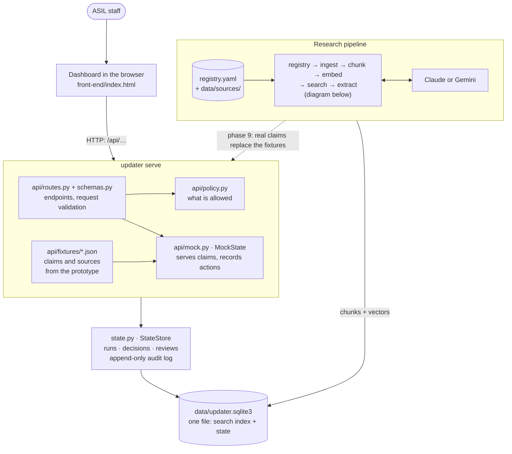
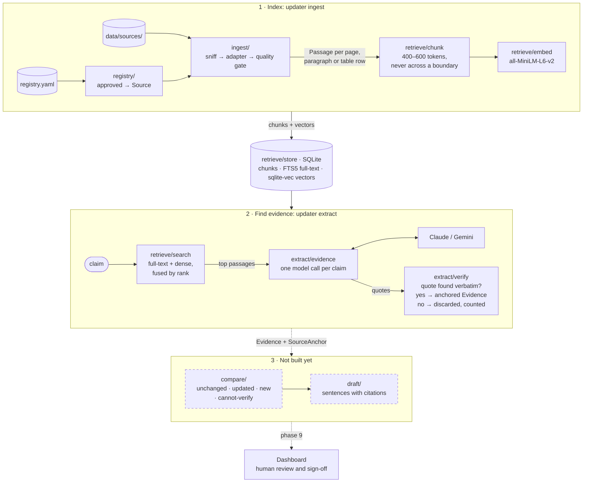

# HITLUpdateAgent

## Overview

The Human-in-the-loop (HITL) Update Agent is an AI-driven research update assistant for the Non-Profit Org: A Start in Life. It is designed to automate the updating process by:

**1.** Re-checking preapproved sources

**2.** Detecting additions or changes

**3.** Extracting relevant findings

**4.** Generating a updated draft where every claim is strictly linked to a cited source

The backend is retrieval-first: every finding is anchored to a page, paragraph or cell range in an approved source, and when the sources do not support a claim it says so instead of filling the gap. `BUILD_SPEC.md` is the contract, `DESIGN.md` carries the five non-negotiable design rules and the decisions log, and `BACKEND_PLAN.md` is the build order.

## Tech Stack

- **Backend**: Python 3.12, the `updater` package (`src/updater`): ingestion, the approved-source registry, hybrid retrieval, evidence extraction with Claude or Gemini, and a FastAPI app for the dashboard
- **Frontend**: the approved dashboard prototype (plain HTML, CSS and JavaScript, no build step), wired to the API in `front-end/index.html` and served by the backend
- **Database**: SQLite, with `sqlite-vec` for embeddings and FTS5 for full-text search
- **Documentation**: `BUILD_SPEC.md`, `DESIGN.md`, `BACKEND_PLAN.md`, `PROJECT_OVERVIEW.md`
- **Testing**: pytest
- **Build Tools**: uv, hatchling

## Getting Started

### Prerequisites

[uv](https://docs.astral.sh/uv/). The project pins Python 3.12; uv fetches it for you.

### Optional (Recommended)

An API key for evidence extraction: Anthropic (the default) or Gemini. Copy `.env.example` to `.env` and fill in the provider, its key and its model; `.env` is gitignored. Everything except `updater extract` and the live tests works without one.

### Installation

1. **Backend**:

   ```bash
   # every extra in one go: uv sync removes the extras it is not given
   uv sync --extra retrieve --extra api --extra gemini --extra prototype
   cp .env.example .env    # then add your API key and model
   uv run pytest
   ```

   `retrieve` is the ML stack (sentence-transformers and sqlite-vec, about 2 GB), `api` is the dashboard's HTTP API, `gemini` is the Gemini provider, and `prototype` is what the group's LlamaIndex prototype in `src/backend` needs. The embedding model downloads from the Hugging Face hub on first use. Behind a TLS-intercepting proxy that fails with a certificate error dressed up as *"couldn't connect to huggingface.co"*; `src/updater/certs.py` handles it.

2. **Frontend**:

   ```bash
   uv run updater serve    # then open http://127.0.0.1:8000/
   ```

   Nothing to install: `updater serve` serves the dashboard at `/` and the API at `/api` from one origin. Its state (decisions, reviews, sign-off, the audit log) is kept in the `--db` file and survives a restart.

3. **Documentation**:

   ```bash
   ///
   TO BE PUT
   ///
   ```

### Development

- Backend API docs: `uv run updater serve`, then http://127.0.0.1:8000/docs
- Frontend: `front-end/index.html`, served at `/` by `updater serve`. It is the approved design in `docs/frontend/asil-dashboard-DRAFT-FINAL.html` with its hardcoded data replaced by API calls; the field names match, so a screen reads the API response exactly as the prototype read its arrays.
- Component library: 
- Documentation: 

### Using the backend

Sources are approved by adding them to `registry.yaml`. Nothing outside that file can be indexed or cited; `updater ingest` refuses an unregistered path.

```sh
uv run updater ingest                          # index every source in the registry
uv run updater ingest data/sources/x.docx      # ... or just this one, if approved
uv run updater search "apprenticeship starts in the North East"
uv run updater extract "Youth unemployment in Western Sydney was 11.4%"
```

`updater search` prints, for each hit, the score, the citation, the chunk id, the character offsets and the text, so a result can be checked against the document by hand. `updater extract` asks the configured model for evidence about a claim and prints every finding whose quote was found, verbatim, in its passage, with its citation, plus how many findings were discarded.

To look at extraction on a document before it is approved:

```sh
uv run python scripts/dump_passages.py data/sources --chunk
uv run python scripts/dump_passages.py data/sources --worst 10
```

The group's Gemini prototype still runs as before:

```sh
cd src/backend && uv run python query.py
```

## Project Structure

```
.
├── src/
│   ├── updater/            # the backend package
│   │   ├── registry/       # approved-source registry: nothing else can be cited
│   │   ├── ingest/         # one extractor per format, each returning anchored passages
│   │   ├── retrieve/       # chunking, embedding, SQLite storage, hybrid search
│   │   ├── extract/        # evidence extraction and quote verification (Claude or Gemini)
│   │   ├── compare/        # four-way claim comparison (not built yet)
│   │   ├── draft/          # draft assembly with citations (not built yet)
│   │   ├── eval/           # evaluation harness (not built yet)
│   │   ├── api/            # FastAPI app the dashboard runs on
│   │   ├── models.py       # the data model: Source, SourceAnchor, Passage, Evidence, Claim
│   │   ├── provenance.py   # the "a chunk stays inside its page" check
│   │   ├── citations.py    # anchor to readable citation ("p. 14", "Sheet1!B4:F4")
│   │   ├── serde.py        # locators to and from JSON and SQLite
│   │   ├── certs.py        # OS certificate store, for TLS-intercepting networks
│   │   ├── state.py        # what people and runs create: decisions, reviews, audit log
│   │   └── cli.py          # updater ingest / search / extract / serve
│   └── backend/            # the group's Gemini/LlamaIndex prototype
├── tests/
├── scripts/                # passage inspector, prototype fixture extraction
├── data/sources/           # documents to ingest; gitignored except its README
├── registry.yaml           # the approved sources
├── front-end/              # the dashboard, wired to the API; served by updater serve
├── docs/frontend/          # the approved prototype, source of truth for the API fixtures
├── .gitlab-ci.yml          # CI/CD pipeline (to come)
└── README.md
```

### Architecture

There are two halves, and they meet in one SQLite file.

- **The research pipeline** reads the approved sources, indexes them, and finds evidence for a claim. It runs from the command line: `updater ingest`, `updater search`, `updater extract`.
- **The dashboard** is where ASIL staff review claims and sign off. A FastAPI server (`updater serve`) serves both the page and the API it calls.

Today the dashboard runs on claims taken from the approved prototype (`api/fixtures/`), so it can be used and tested while the pipeline is still being built. Connecting the pipeline's real output to the API is phase 9 of `BACKEND_PLAN.md`.



### The research pipeline

Each stage hands the next one text that still carries its `SourceAnchor`: which approved source, which page, paragraph or cell range, and which characters within it. That anchor is what becomes the citation in the draft, so no stage is allowed to drop it. Dashed boxes are not built yet.



### What each part does

**Research pipeline** (`src/updater/`)

| Part | What it does |
|---|---|
| `registry.yaml` and `registry/` | The list of approved sources and the code that enforces it. `Registry.source_for_path` and `Registry.get` refuse anything not listed, and without a `Source` nothing can be ingested or cited. This is design rule 3 (approved sources only) as a function. |
| `ingest/` | Turns a file into `Passage`s, each with an anchor. `sniff.py` works out the real format from the file's contents rather than its extension. One adapter per format in `adapters/` (PDF by page, DOCX by paragraph and table row, HTML by block under its heading trail, XLSX and CSV by row). `tabular.py` finds header rows and writes each table row as `Header: value; Header: value` so numbers keep their meaning. `quality.py` rejects a whole document if any of its text looks broken, rather than silently dropping part of it. |
| `retrieve/chunk.py` | Splits long passages into 400–600 token chunks with 15% overlap. A chunk never crosses a page, paragraph or row boundary, and `provenance.require_derives_within` checks that on every chunk. |
| `retrieve/tokenize.py`, `retrieve/embed.py` | Counts tokens the way the embedding model does, and embeds chunks with `all-MiniLM-L6-v2`. A chunk longer than the model's 256-token window is embedded as several overlapping windows rather than cut off. |
| `retrieve/store.py`, `retrieve/index.py` | Keeps chunks, an FTS5 full-text index and `sqlite-vec` vectors in one SQLite file. `index.py` runs a source through ingest, chunk, embed and store; re-indexing replaces a source's chunks in one transaction. |
| `retrieve/search.py` | Hybrid retrieval. Full-text search finds exact figures like `$109,860`, which dense search alone cannot; dense search finds paraphrases. The two rankings are fused by reciprocal rank. |
| `extract/` | Sends a claim and its retrieved passages to the model (`evidence.py`), with the reply constrained to a JSON schema. `verify.py` then finds each quote verbatim in the passage it names and builds its anchor; anything it cannot find is discarded and counted. `model.py` is the provider interface, `claude.py` and `gemini.py` implement it, and `provider.py` picks one from `UPDATER_MODEL_PROVIDER`. |
| `compare/`, `draft/`, `eval/` | Not built yet. Each holds a short brief for its stage: classify claims as unchanged, updated, new or cannot-verify; assemble the draft with inline citations; measure citation accuracy. |

**Shared by every stage** (`src/updater/`)

| Part | What it does |
|---|---|
| `models.py` | The data model. `Source`, `SourceAnchor`, `Passage`, `Evidence`, `Claim`, `ComparisonResult`, and one locator type per kind of place in a document (`PageLocator`, `BlockLocator`, `CellLocator`, `DomLocator`, `SlideLocator`, `TimeLocator`). Records are frozen, so an anchor cannot be edited after it is made. |
| `provenance.py` | `require_derives_within(parent, child)`: the check that a chunk's anchor stays inside its parent's page, paragraph or row. |
| `citations.py` | Turns an anchor into the citation a reviewer reads: `p. 14`, `paragraph 194`, `Salary Premiums!A13:D13`. |
| `serde.py` | Saves locators to JSON and SQLite and reads them back. |
| `certs.py` | Exports the Windows certificate store so model downloads work behind a TLS-intercepting proxy. |

**The dashboard and its API**

| Part | What it does |
|---|---|
| `front-end/index.html` | The approved dashboard design, with its hardcoded data replaced by calls to `/api`. Plain HTML, CSS and JavaScript; no build step. |
| `api/app.py` | `create_app()`: builds the FastAPI app, maps each kind of refusal to an HTTP status, and serves `front-end/` at `/`, mounted after the API so `/api` and `/docs` always reach the API. |
| `api/routes.py`, `api/schemas.py` | The endpoints, grouped by dashboard screen (registry, scan, extraction, draft review, sign-off, settings), and the Pydantic models for every request and response. Unknown fields are rejected, so a client cannot, for example, create a source that is already approved. The field descriptions appear at `/docs`. |
| `api/policy.py` | The rules as plain functions: a new source starts as pending, a scan refuses unapproved sources, a claim that cannot be verified cannot enter the draft, and sign-off needs a verdict on every draft claim. |
| `api/mock.py` | `MockState`: serves the fixture claims and records what people do through `state.py`. Phase 9 replaces its fixture claims with the pipeline's. |
| `api/fixtures/` | JSON extracted from the approved prototype by `scripts/extract_prototype_fixtures.py`. The test suite fails if the prototype changes and the fixtures are not regenerated. |
| `state.py` | `StateStore`: runs, decisions, reviews, source approvals, settings and the audit log, kept in the same SQLite file as the search index but in tables of its own. Database triggers refuse any edit or deletion of the audit log. |

**Everything else**

| Part | What it does |
|---|---|
| `cli.py` | The `updater` command: `ingest`, `search`, `extract` and `serve`. |
| `scripts/dump_passages.py` | Shows what ingestion extracts from a document before it is approved. `--worst 10` lists the passages with the lowest share of letters and digits, which is where wrong table labels have shown up. |
| `docs/frontend/` | The approved dashboard prototype, kept as the source of truth for the fixtures. |
| `src/backend/` | The group's original Gemini/LlamaIndex prototype (`query.py`, `repoagent.py`). It runs on its own and does not share code with `updater`. |
| `tests/` | `uv run pytest`. Covers every stage above, the API's rules, and that every API call in the page matches a real endpoint. |

### How it comes together

1. **Approving a source.** Someone adds the document to `registry.yaml` and puts the file in `data/sources/`. Nothing else in the system can make a source citable.
2. **Indexing** (`updater ingest`). Each approved file is identified, read by the right adapter into anchored passages, checked by the quality gate, chunked, embedded and saved. A finished index is a set of chunks in SQLite, each still pointing at an exact place in a document.
3. **Finding evidence** (`updater extract "<claim>"`). The claim is searched both ways, full-text and dense, and the top passages go to Claude or Gemini with a request for supporting quotes. Each quote is matched back against the source text. Only quotes found word for word survive, with their anchors; if nothing survives, the result is empty, and the later compare stage will mark that claim cannot-verify.
4. **Reviewing** (`updater serve`, then open http://127.0.0.1:8000/). The dashboard calls the API for the claims, the draft and the sources. Every decision, review and source change goes through `policy.py` and is written to the SQLite file with an audit entry. Sign-off is recorded there too; nothing is ever published automatically.
5. **Still to connect.** Steps 2 and 3 work from the command line, and step 4 works in the browser on prototype claims. The compare and draft stages (phases 6 and 7) and wiring the pipeline into the API (phase 9) join them up.

## Testing

- **Backend**: `uv run pytest`. The paid live tests against the model APIs are deselected by default; run them with `uv run pytest -m live`.
- **Frontend**: `tests/test_api_frontend.py` checks every API call the page makes against the API's own routes, and that none of the prototype's hardcoded data is left in it.

## Documentation

For detailed guides on setup, development, architecture, and usage, please refer to the [full documentation](TO BE DECIDED) (run `TO BE DECIDED` to start the docs server).

## License

This project is part of UTS Software Design Development Course work. All
